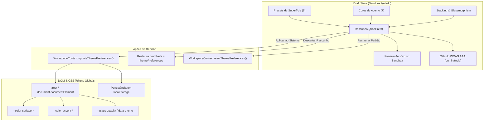

# OPSFLOW — Motor de Personalização Visual & Sandbox de Temas

Documentação técnica do subsistema de **Dynamic-Theming**, **Multi-Layer Background Stacking**, **Adaptive Glassmorphism**, cálculo determinístico de **Luminância Relativa WCAG** e o padrão arquitetural **Draft State / Sandbox Pattern** implementados na aba de Perfil do Usuário (`/profile`).

---

## 1. Visão Geral e Filosofia de Engenharia

O motor de temas do **OPSFLOW** foi concebido sob três premissas fundamentais:

1. **Conforto Operacional Contínuo (24/7):** As operações de infraestrutura, suporte e triagem demandam longas horas de foco visual. A paleta descarta tons fluorescentes e reflexos excessivos em favor de superfícies carbono fosco (*Atelier Monolith*), alto contraste onde necessário e controle estrito de brilho.
2. **Isolamento de Rascunho (*Sandbox Pattern*):** O usuário deve poder experimentar presets, cores de destaque, níveis de translucidez e camadas de profundidade em um ambiente hermético sem que a interface principal sofra repinturas parciais ou perca o estado de trabalho.
3. **Acessibilidade Determinística (WCAG 2.1 AAA):** Cada combinação de fundo e cor de acento passa por um pipeline em tempo real de cálculo matemático de luminância relativa e taxa de contraste, informando o operador se a combinação atende ou não aos critérios de legibilidade.



---

## 2. Padrão Sandbox (Draft State Pattern)

### O Problema do Theming Tradicional
Na maioria das aplicações web, cada clique em uma cor ou slider dispara alterações imediatas nas variáveis CSS globais ou no estado raiz. Isso gera:
- **Layout Thrashing & Flickering:** Repinturas pesadas e recálculo de CSSOM da página inteira a cada movimento de slider.
- **Perda de Contexto:** Se o operador escolher uma cor com contraste inadequado por engano, a interface inteira pode se tornar ilegível antes que ele consiga desfazer.

### A Solução Sandbox
O componente `ProfileThemeSandbox` mantém uma cópia desacoplada do estado:

```typescript
// Estado ativo no sistema (WorkspaceContext)
const { themePreferences, updateThemePreferences, resetThemePreferences } = useWorkspace();

// Estado de Rascunho Isolado (Sandbox)
const [draftPrefs, setDraftPrefs] = useState<UserThemePreferences>(themePreferences);

// Detecção atômica de sujeira (Dirty State)
const isDirty = useMemo(
  () => JSON.stringify(draftPrefs) !== JSON.stringify(themePreferences),
  [draftPrefs, themePreferences]
);
```

- Todas as alterações visuais ocorrem **apenas no espelho local** do Sandbox.
- O card de simulação dentro do Sandbox renderiza chamados de teste, botões primários e secundários, inputs e badges usando os estilos computados do rascunho.
- O sistema principal só é reconfigurado quando o usuário dispara expressamente a função `handleApplyToSystem()`.

---

## 3. Presets Arquitetônicos de Superfície (Dynamic-Theming)

O sistema oferece **5 presets de fundo**, cada um calibrado com valores específicos para `surfaceCanvas`, `surfaceLowest`, `surfacePanel` e `surfaceElevated`:

| Preset | Canvas | Lowest (Sidebar) | Panel (Cards) | Elevated (Popovers) | Proposta de Uso |
| :--- | :--- | :--- | :--- | :--- | :--- |
| **Atelier Carbon** *(Padrão)* | `#131313` | `#0e0e0e` | `#171717` | `#1b1b1b` | Matte cinza neutro balanceado, sem dominância cromática. |
| **Obsidian Slate** | `#0f1216` | `#0a0d11` | `#161b22` | `#1c2128` | Ardósia grafite fria inspirada em consoles de infraestrutura moderna. |
| **Midnight Sky** | `#0b0f19` | `#070a11` | `#111827` | `#1e293b` | Preto azulado aeroespacial de alta imersão para operações 24/7. |
| **Cyber Amber** | `#090909` | `#040404` | `#141414` | `#1a1a1a` | Preto absoluto OLED de alto contraste industrial. |
| **Emerald Matrix** | `#0d1410` | `#080d0a` | `#131f17` | `#1a2b21` | Tons esmeralda profundos inspirados em terminais UNIX e NOCs de telecom. |

---

## 4. Acentos Semânticos (7 Cores de Destaque)

As cores de destaque são aplicadas em botões de ação principal, bordas ativas de foco, barras de progresso e badges de status:

```typescript
export const ACCENT_COLOR_CONFIGS: Record<AccentColor, AccentColorConfig> = {
  sage:     { id: 'sage',     name: 'Sage (Sálvia)',   hex: '#6ee7b7', muted: '#12261e', highlight: '#a7f3d0' },
  sky:      { id: 'sky',      name: 'Sky (Celeste)',   hex: '#7dd3fc', muted: '#14222e', highlight: '#bae6fd' },
  lavender: { id: 'lavender', name: 'Lavender',        hex: '#a5b4fc', muted: '#191c33', highlight: '#c7d2fe' },
  amber:    { id: 'amber',    name: 'Amber (Âmbar)',   hex: '#fcd34d', muted: '#292112', highlight: '#fde68a' },
  coral:    { id: 'coral',    name: 'Coral',           hex: '#fda4af', muted: '#291518', highlight: '#fecdd3' },
  emerald:  { id: 'emerald',  name: 'Emerald (Verde)', hex: '#34d399', muted: '#0e2b1f', highlight: '#6ee7b7' },
  cyan:     { id: 'cyan',     name: 'Cyan (Ciano)',    hex: '#22d3ee', muted: '#082f38', highlight: '#67e8f9' },
};
```

---

## 5. Multi-Layer Background Stacking (Profundidade Espacial)

A profundidade tridimensional da interface é composta pela sobreposição de **4 camadas independentes**, que podem ser ligadas ou desligadas individualmente no Sandbox:

1. **Camada 0 — Base Solid (`baseSolid`):**
   - Superfície física contínua preenchida com a cor base do preset (`surfaceCanvas`).
2. **Camada 1 — Blueprint Grid (`blueprintGrid`):**
   - Malha técnica ortogonal de precisão (`28px x 28px`) simulando plantas de arquitetura e pranchas de engenharia:
   ```css
   background-image: 
     linear-gradient(to right, rgba(255, 255, 255, 0.05) 1px, transparent 1px),
     linear-gradient(to bottom, rgba(255, 255, 255, 0.05) 1px, transparent 1px);
   background-size: 28px 28px;
   ```
3. **Camada 2 — Ambient Glow (`ambientGlow`):**
   - Fonte de luz difusa suave (`blur-3xl`, `opacity-15`) posicionada no canto superior direito, cuja cor acompanha dinamicamente a cor de acento selecionada.
4. **Camada 3 — Film Noise Texture (`noiseTexture`):**
   - Textura estocástica analógica (ruído gaussiano sutil em SVG data URI) que quebra o efeito de *color banding* em monitores de alta gama de cor e confere acabamento tátil à interface.

---

## 6. Adaptive Glassmorphism & Luminância Relativa ($L$)

### Translucidez Sem Traps de Empilhamento
O slider de vidro adaptativo varia a opacidade entre **0% (100% Opaco)** e **40% (Translúcido Intenso)**.
O valor é injetado como variável CSS:
```css
--glass-opacity: 0.16;
```
Aplicado nas superfícies através de:
```css
background-color: rgba(23, 23, 23, calc(1 - var(--glass-opacity, 0.16)));
backdrop-filter: blur(12px);
```
Isso garante efeito visual moderno sem aplicar filtros de desfoque nos containers intermediários da árvore de elementos, preservando o alinhamento de menus suspensos e garantindo 60fps na GPU.

### Formulação Matemática de Luminância Relativa (WCAG 2.1)
Para converter qualquer cor hexadecimal RGB em sua luminância linear percebida pelo olho humano, o sistema executa o algoritmo oficial do W3C:

1. **Normalização do canal sRGB para a faixa $[0, 1]$:**
   $$C_{\text{norm}} = \frac{C_{\text{8bit}}}{255}$$

2. **Linearização inversa de Gamma:**
   $$C_{\text{linear}} = \begin{cases} \frac{C_{\text{norm}}}{12.92}, & \text{se } C_{\text{norm}} \le 0.04045 \\ \left(\frac{C_{\text{norm}} + 0.055}{1.055}\right)^{2.4}, & \text{se } C_{\text{norm}} > 0.04045 \end{cases}$$

3. **Cálculo da Luminância Relativa ($L$):**
   $$L = 0.2126 \times R_{\text{linear}} + 0.7152 \times G_{\text{linear}} + 0.0722 \times B_{\text{linear}}$$

4. **Taxa de Contraste entre duas cores ($L_1 > L_2$):**
   $$\text{Contraste} = \frac{L_1 + 0.05}{L_2 + 0.05} : 1$$

O Sandbox exibe o valor calculado de $L$ para a superfície e para o acento, emitindo um selo **WCAG AAA** quando a taxa de contraste com texto branco for superior a $7.0:1$.

---

## 7. Densidade de Interface

A densidade de interface reconfigura os espaçamentos internos (*padding*) e alturas de linha através do atributo `data-density`:

- `compact`: Células e botões com `py-1.5 px-2.5` e fontes `text-xs`. Ideal para analistas com monitores ultrawide acompanhando filas com dezenas de chamados.
- `comfortable` *(Padrão)*: Altura de linha padrão `py-2.5 px-3.5`, garantindo leitura ergonômica sem poluição.
- `spacious`: Padding ampliado `py-3.5 px-5`, facilitando o toque em laptops com touchscreen e leitura relaxada de relatórios.

---

## 8. Persistência e Aplicação no DOM

Quando o usuário clica em **"Aplicar ao Sistema"**, o método `applyThemeToDOM` do [`WorkspaceContext`](file:///c:/Users/dkaua/Documents/Projetos%20Pessoais/Projetos/Opsflow/opsflow/opsflow-web/src/entities/session/model/WorkspaceContext.tsx) executa:

```typescript
const applyThemeToDOM = (prefs: UserThemePreferences) => {
  const root = document.documentElement;
  const presetConfig = THEME_PRESET_CONFIGS[prefs.preset];
  const accentConfig = ACCENT_COLOR_CONFIGS[prefs.accent];

  // Atributos semânticos para Tailwind e CSS Selectors
  root.setAttribute('data-theme', prefs.preset);
  root.setAttribute('data-accent', prefs.accent);
  root.setAttribute('data-density', prefs.density);

  // Variáveis de superfície
  root.style.setProperty('--color-surface-canvas', presetConfig.surfaceCanvas);
  root.style.setProperty('--color-surface-lowest', presetConfig.surfaceLowest);
  root.style.setProperty('--color-surface-panel', presetConfig.surfacePanel);
  root.style.setProperty('--color-surface-elevated', presetConfig.surfaceElevated);

  // Variáveis de acento
  root.style.setProperty('--color-accent-primary', accentConfig.hex);
  root.style.setProperty('--color-accent-muted', accentConfig.muted);
  root.style.setProperty('--color-accent-highlight', accentConfig.highlight);

  // Vidro e bordas
  root.style.setProperty('--glass-opacity', (prefs.glassOpacity / 100).toFixed(2));
  
  // Persistência local segura
  localStorage.setItem('opsflow_theme_prefs', JSON.stringify(prefs));
};
```

---

## 9. Suíte de Testes Automatizados

O comportamento do Sandbox e dos cálculos de luminância é coberto por testes em `src/__tests__/profile.integration.test.tsx`:

- **Isolamento de Rascunho:** Comprova que ao clicar em um novo preset, o selo muda para *"Rascunho Ativo (Não Salvo)"* enquanto as variáveis do `:root` permanecem intactas até a aplicação explícita.
- **Cálculo Matemático:** Valida que `calculateRelativeLuminance('#0f1216')` e `calculateContrastRatio('#ffffff', '#0f1216')` retornam valores conformes com a especificação WCAG ($\ge 10:1$).
- **Injeção de CSS:** Verifica se `document.documentElement` recebe `data-theme="obsidian-slate"` e a variável `--color-surface-canvas: #0f1216`.
- **Restauração de Padrões:** Garante que o acionamento de restauração reseta para o preset `atelier-carbon` e acento `sage`.
